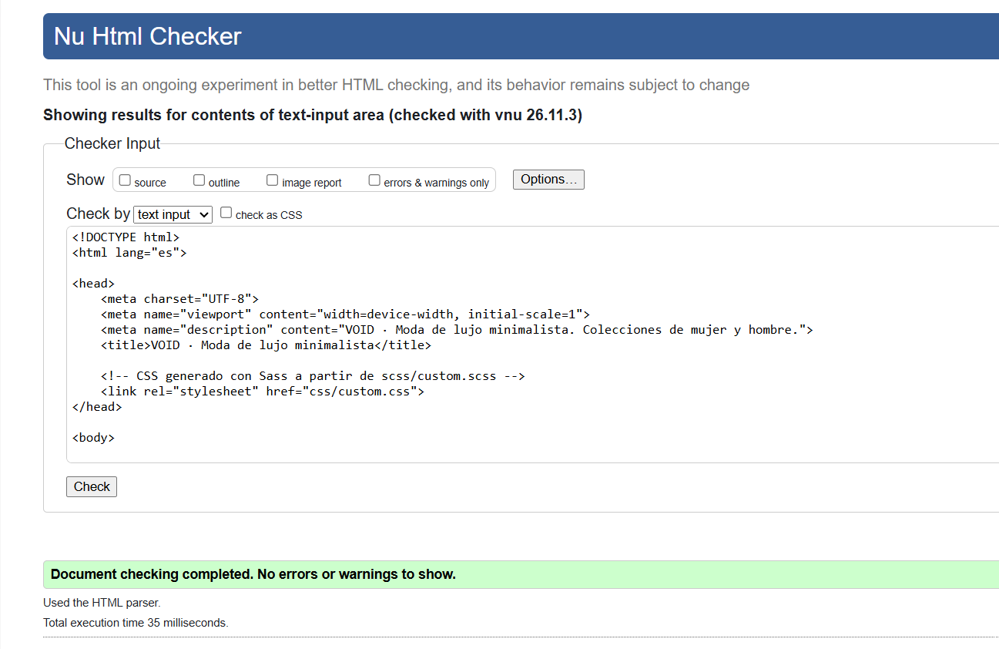

# VOID · Práctica de maquetación

E-commerce de moda minimalista realizado con **HTML5, Sass y Bootstrap 5.3**.
El proyecto es mobile-first y usa la rejilla de 12 columnas, componentes nativos de
Bootstrap y un Offcanvas para el carrito.

## Estructura

```
void/
├── index.html              → Home: navbar, hero, newsletter y footer
├── login.html              → Acceso de usuario, formulario
├── css/
│   └── custom.css          → CSS compilado desde Sass 
├── scss/
│   ├── _variables.scss     → Colores, fuentes y bordes del UI Kit
│   ├── _botones.scss       → Retoques planos de botones y marca
│   ├── _header.scss        → Cabecera dinámica 
│   ├── _offcanvas.scss     → Menú lateral de categoría
│   ├── custom.scss         → Archivo principal que se compila
│   └── bootstrap/          → Fuente SCSS local de Bootstrap 5.3.8
├── js/
│   ├── bootstrap.bundle.min.js
│   └── script.js           → Validación de formularios + control de Offcanvas + cabecera dinámica
├── img/                    → Imágenes locales
├── LICENSE-LUCIDE.txt      → Licencia de los iconos Lucide
├── .gitignore 
└── .vscode/settings.json   → Configuración de Live Sass Compiler
```

## Capturas de validacion


## Créditos

- Iconos del header: [Lucide](https://lucide.dev) v1.67.0, licencias ISC/MIT.
  Consulta `LICENSE-LUCIDE.txt` para el texto completo.
