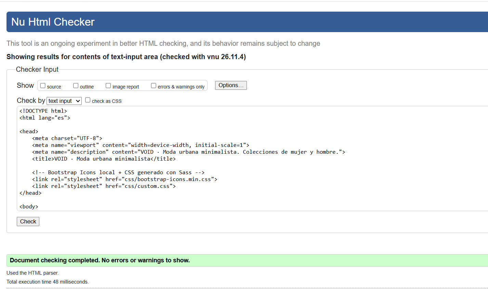
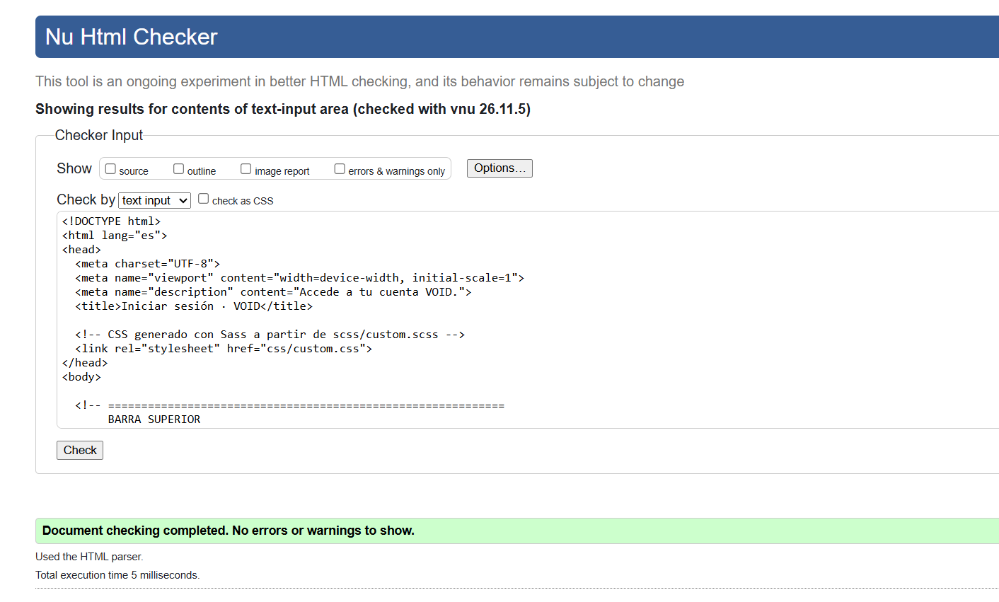
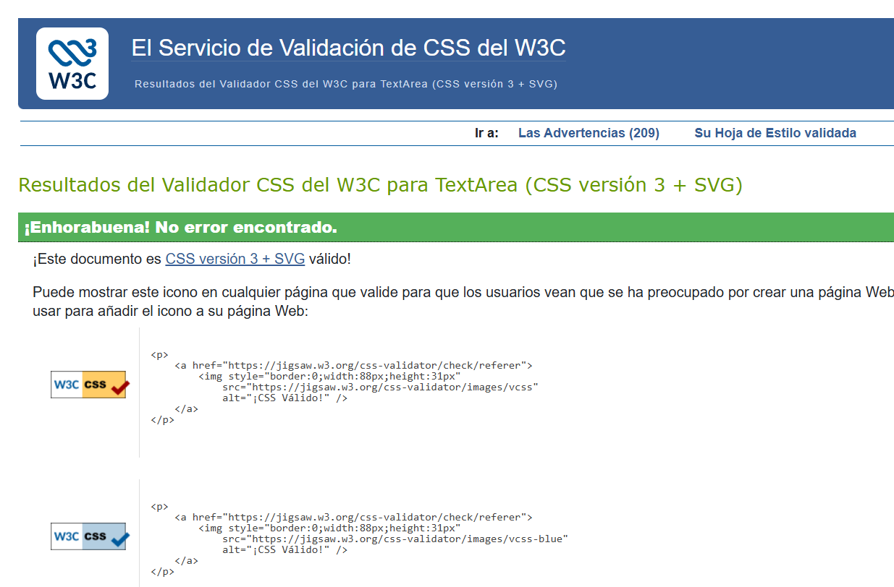

# VOID · Práctica de maquetación

Plataforma de moda desarrollada con HTML5, Sass y Bootstrap 5.3** bajo arquitectura mobile-first. 

El sitio aprovecha el sistema de rejilla y utilidades de Bootstrap para ofrecer una experiencia editorial, complementada con paneles Offcanvas nativos de Bootstrap tanto para el carrito de compras como para una interfaz de búsqueda interactiva con prendas sugeridas.

## Estructura

```
void/
├── index.html              → Home: navbar, hero, categorías, newsletter, footer y paneles offcanvas
├── login.html              → Acceso de usuario, formulario
├── css/
│   ├── custom.css          → CSS compilado desde Sass
│   ├── bootstrap-icons.min.css → Bootstrap Icons local
│   └── fonts/              → Fuentes de Bootstrap Icons
├── scss/
│   ├── _variables.scss     → Colores, fuentes y bordes del UI Kit
│   ├── _botones.scss       → Retoques planos de botones y marca
│   ├── _header.scss        → Cabecera dinámica 
│   ├── _offcanvas.scss     → Menú lateral de categoría
│   ├── custom.scss         → Archivo principal que se compila
│   └── bootstrap/          → Fuente SCSS local de Bootstrap 5.3.8
├── js/
│   ├── bootstrap.bundle.min.js
│   └── script.js           → Validación de formularios + control de Offcanvas + cabecera dinámica
├── img/                    → Imágenes locales
├── .gitignore 
└── .vscode/settings.json   → Configuración de Live Sass Compiler
```

## Capturas de validación

Validación de index.html:

Validación de login.html:

Validación de custom.css:


